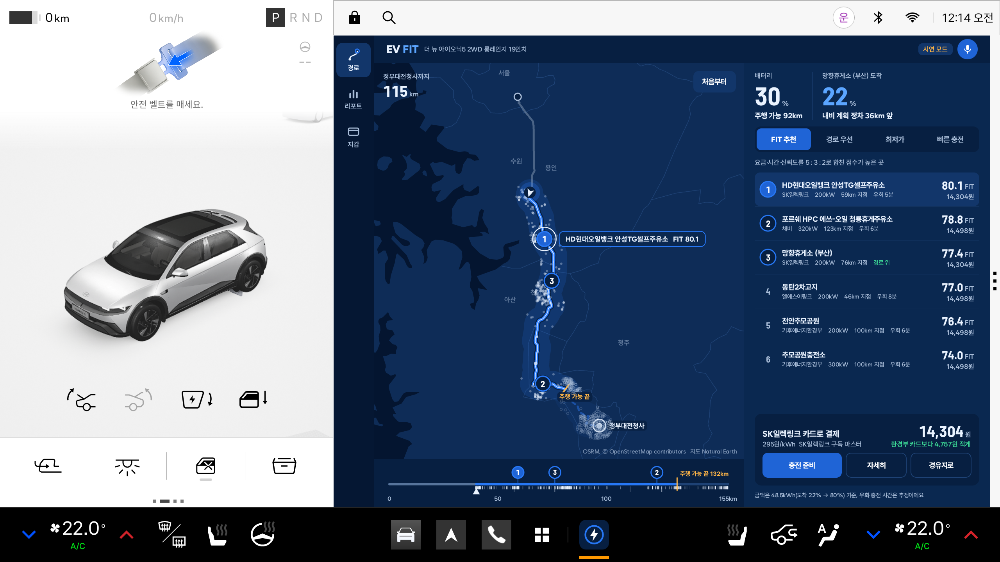
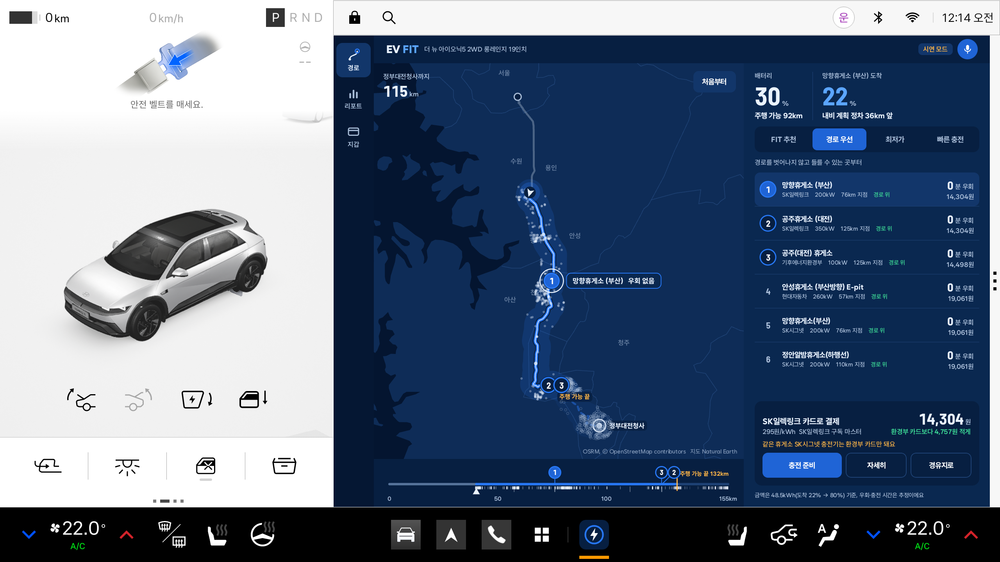
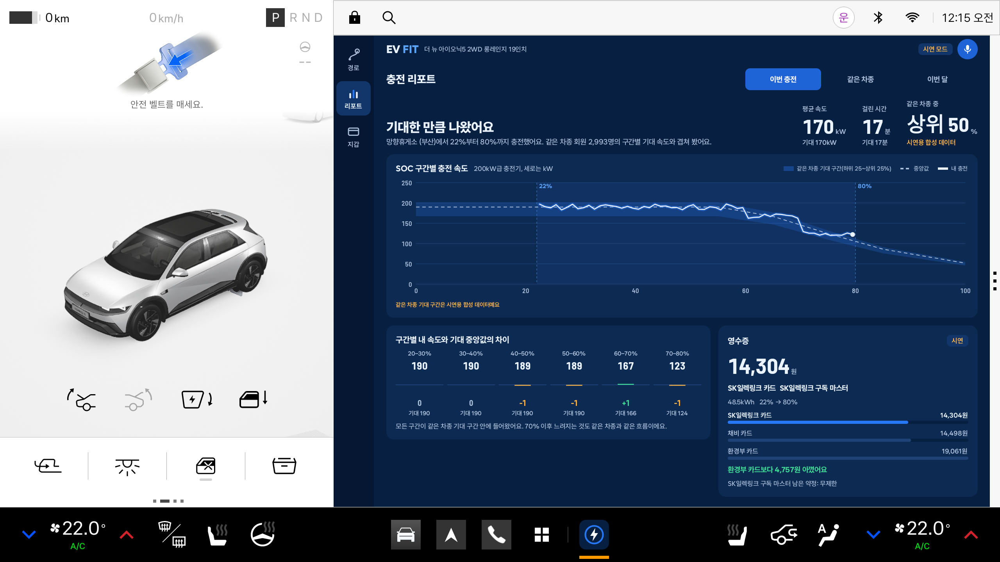
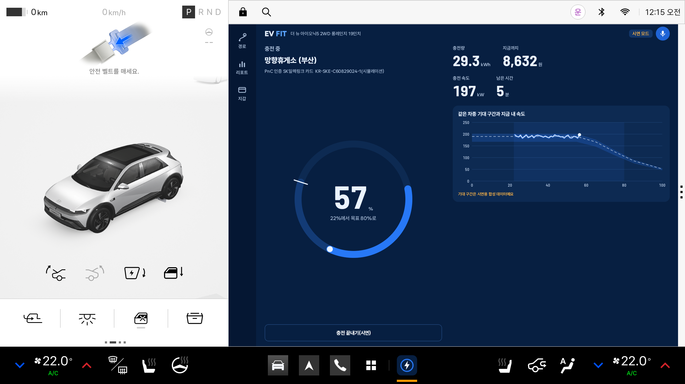

<!-- EV FIT 저장소 안내 — 공모전 제출 요건(한 줄 소개·실행 방법·테스트 환경·APK 위치) 포함 -->

# EV FIT (이브이 핏)

> **내 차에 딱 맞는 충전, EV FIT**

내가 가진 결제수단(환경부 카드·충전사업자 회원·구독)으로 **실제로 내는 요금**, 경로·충전 시간, 동일 차종 충전 경험을 차가 종합해 **가장 잘 맞는 충전소와 결제 계정**을 고르고, PnC 충전까지 준비하는 현대자동차그룹 Pleos Connect용 차량 앱입니다.

## 브랜드

- **네이밍**: Electric Vehicle + FIT("꼭 맞다"). 모든 운전자에게 가장 좋은 충전소는 없지만, 나에게 가장 잘 맞는 충전소는 있습니다.
- **Brand Essence** Personalized Charging · **Brand Promise** The Right Charge for You(최저가만이 아니라 실제 요금·거리·충전 시간·경험 종합) · **Brand Vision** Effortless EV Charging
- **F**ind Your Best · **I**ntelligent Choice · **T**ailored Experience

## 핵심 기능

| 기능 | 내용 |
|---|---|
| **FIT Price** | 환경부 공시 요금 매트릭스(회원가·로밍가)와 구독 약정 잔량·고속도로 적용 여부를 반영해 충전소마다 결제 계정별 예상 요금을 계산하고 가장 싼 계정을 고른다 |
| **FIT Route** | 지도에 이번 경로를 회랑으로 그리고, 경로 옆 5km 안 충전소 중 남은 배터리로 닿는 곳을 탭 기준(FIT 추천·경로 우선·최저가·빠른 충전)으로 골라 ①②③으로 표시한다. 진행 방향 휴게소는 우회 0분, 반대 방향 휴게소는 뺀다. 고른 충전소를 내비 경유지로 넘긴다 |
| **FIT Insight** | 충전 중 차량 SOC 변화로 잰 내 충전 곡선을 같은 차종 기대 구간(SOC×kW) 위에 겹치고, 구간별 차이·평균 속도·걸린 시간·결제 수단별 영수증을 비교하는 리포트, 같은 차종 회원 속도 분포, 이번 달 지출·절약·구독 약정 |
| 충전 준비 | 도착 전 결제 계정 확정, PnC 계약 전환(시뮬레이션), 충전구 열기, 목표 충전량 설정, 충전 전 확인 안내 |
| 음성 | 다음 충전·충전 준비·완료 음성 안내, "가장 싼 충전소" 같은 음성 명령 |

## 화면 (Pleos Connect Emulator v2.1.0, 시연 모드)

| 경로 지도 — FIT 추천 | 경로 우선 탭 — 경로 위 휴게소부터 |
|---|---|
|  |  |
| **충전 리포트 — 같은 차종 기대 구간 위 내 충전 곡선** | **충전 중 — SOC 링과 실시간 곡선** |
|  |  |

전체 10장(최저가 탭·상세·충전 준비·같은 차종·이번 달·지갑 포함)은 `docs/screenshots/`에 있습니다. `bash tools/demo_flow.sh`로 같은 흐름을 다시 캡처할 수 있습니다.

## 실행 방법

1. **Pleos Connect Emulator v2.1.0(API 34) 준비**
   - Android Studio > SDK Manager > SDK Update Sites에 `https://nexus-playground.pleos.ai/repository/raw-releases/connect-avd/2.x/crp-sys-img.xml` 추가
   - SDK Platforms > Android API 34 > `Pleos Connect system Image` 설치, SDK Tools > `Android Emulator` 설치
   - Device Manager > Automotive > `Pleos Connect v2.1.0`, Default boot `Cold`, RAM `4 GB`로 AVD 생성 후 실행
   - Android Studio 화면에 Pleos 기기가 안 보이면 명령줄로 만듭니다(기기 정의는 시스템 이미지에 포함). 만든 뒤 `~/.android/avd/Pleos_Connect_v2.1.avd/config.ini`에서 `hw.ramSize=4096M`, `fastboot.forceColdBoot=yes`, `hw.gpu.enabled=yes`로 바꿉니다.
     ```bash
     avdmanager create avd -n Pleos_Connect_v2.1 -k "system-images;android-34;pleos_car_emulator;x86_64" -d Pleos_Connect_v2_0
     emulator -avd Pleos_Connect_v2.1
     ```
2. **설치·실행**
   ```bash
   adb install -r apk/<APK 파일명>.apk
   adb shell am start -n com.ian.evfit/.MainActivity
   ```
3. **시연 모드(처음 실행 시 켜져 있음)** — 경로 화면에서 순서대로 누릅니다.
   1. 지도 오른쪽 위 **[시연 시작]**: 양재 → 정부대전청사 경로(156km)를 주행 중, 40km 지점에서 SOC 30%(주행 가능 92km). 내비 계획 정차는 망향휴게소(부산), 도착 예상 22%
   2. 탭 **[FIT 추천] [경로 우선] [최저가] [빠른 충전]**: 지도 ①②③과 오른쪽 목록이 기준에 따라 바뀝니다. 금액은 모두 같은 충전량(48.5kWh, 22%→80%) 기준
   3. **[경로 우선]** 1위 망향휴게소: SK일렉링크 카드(구독 마스터 295원/kWh) 14,304원, 환경부 카드보다 4,757원 적게, 같은 휴게소 SK시그넷 충전기는 환경부 카드만 가능
   4. **[자세히]** → FIT 점수 근거(요금·시간·신뢰도)와 결제 수단별 금액 → **[충전 준비]**: 차가 경로를 따라 망향휴게소까지 이동한 뒤 준비 화면(PnC 계약 전환·충전구 열기·목표 80%)
   5. **[충전 시작(시연)]** → 약 20초 재생(실제 약 17분을 60배 압축) 후 리포트 자동 진입
4. **실차 모드** — 지갑 > 시연 모드 끄기. 차량 상태는 Virtual Console로 바꿉니다.
   ```bash
   adb forward tcp:8088 tcp:8088   # 브라우저에서 http://127.0.0.1:8088/
   ```
   Virtual Console은 브라우저 창이 열려 있어야(하단 `DDS ONLINE`) 값을 바꿀 수 있습니다. Energy 도메인의 Battery SOC를 바꾸면 앱 SOC가, Charge Switch를 On으로 바꾸면 충전 기록이 시작되고 목표 SOC에 닿으면 자동 종료됩니다. 앱의 [충전 준비]가 연 충전구는 Charge Port Open으로 보입니다.
   에뮬레이터 GPS 기본값은 미국 마운틴뷰라 주변 충전소가 없습니다. 국내 위치로 바꿉니다.
   ```bash
   adb emu geo fix 126.9780 37.5665   # 경도 위도 순, 서울시청
   ```
5. **주행 중 제한 확인**: Virtual Console에서 기어를 D로 두고 가속하면 주행 상태가 됩니다. 이때 충전소 목록이 5개로 줄고 지갑 편집이 잠기며, 상단에 `주행 중` 배지가 뜹니다.

## 테스트 환경 및 필요한 설정

| 항목 | 값 |
|---|---|
| 개발 PC | Windows 11, JDK 17 |
| 빌드 | Gradle 8.13(Wrapper 포함), AGP 8.10.1, Kotlin 2.1.20, Jetpack Compose(BOM 2024.12.01) |
| SDK 버전 | compileSdk 36 / targetSdk 34 / minSdk 28 |
| 실행 환경 | Pleos Connect Emulator v2.1.0(API 34) |
| Pleos SDK | `ai.pleos.playground:Vehicle:2.3.2`, `NaviHelper:3.0.5`, `FusedLocation:1.1.3`, `TextToSpeech:3.3.1`, `SpeechToText:3.3.1` (저장소 `https://nexus-playground.pleos.ai/repository/maven-releases/`) |
| 퍼미션 | `pleos.car.permission.CAR_ENERGY`, `CONTROL_CAR_ENERGY`, `CAR_INFO`, `NAVI_ROUTE`, `NAVI_ROUTE_SEARCH`, `NAVI_CUSTOM_MAP`, `FUSED_LOCATION`, `TTS_SERVICE`, `STT_SERVICE` |
| 네트워크 | 실행 중 불필요(요금·충전소 데이터는 APK에 포함) |
| 계정 | 불필요(Vehicle·NaviHelper는 신청 없이 사용, TTS·STT는 ON_DEVICE 모드) |

## APK 위치

`apk/` 폴더의 release APK(파일명 형식 `팀명_EVFIT_release.apk`, APK Signature Scheme v3 서명).

## 소스 빌드

```bash
./gradlew assembleRelease     # 서명 키가 없으면 debug 키로 서명
./gradlew testDebugUnitTest   # 요금 엔진·FIT 점수·자산 파싱 등 단위 테스트
```

## 데이터 출처와 고지

- 요금: 무공해차 통합누리집 '전기차 충전요금 안내'(기후에너지환경부) 사업자별 회원가·로밍요금 매트릭스, 2026-10-24 수집
- 충전소: 환경부 전기차 충전소 현황 2026-08 기준(급속 충전소 24,090곳)
- 구독: 현대자동차 EV 에브리케어, 채비, SK일렉링크 공식 페이지(2026-10-24 확인)
- **동일 차종 충전 통계·성공률·만족도는 시연용 합성 데이터**입니다(공식 제원·실측 통계 아님).
- **충전사업자 연동과 PnC 계약 전환은 앱 안의 목(mock) 시뮬레이션**입니다. 실제 결제는 하지 않습니다.
- **FIT 점수** = 후보 충전소끼리 최소-최대 정규화한 요금 50% + 시간 30%(경로 추가 이동 = 거리×2분 추정 + 예상 충전 시간) + 신뢰도 20%(합성 성공률). 가중치와 시간 추정은 시연용 가정입니다.
- 지도: Natural Earth 10m(퍼블릭 도메인). 시연 경로선: OSRM, © OpenStreetMap contributors(ODbL). 실차 모드는 내비가 경로 좌표를 주지 않아 현재 위치·정차지·목적지를 직선으로 잇는다(추정).
- 우회 시간 = 경로에서 떨어진 거리×2×1.2분(+고속도로 경로에서 일반 충전소면 나들목 5분), 주행 가능 거리 = (SOC−10%)×배터리×차종 전비. 모두 추정입니다.
- 글꼴: Wanted Sans, Barlow Semi Condensed(둘 다 SIL OFL 1.1, `app/src/main/assets/licenses/`).
- EV FIT은 공모전 컨셉 브랜드이며 현대자동차 공식 브랜드 자산이 아닙니다.

## 프로젝트 구조

```
app/src/main/java/com/ian/evfit/
  engine/    요금 엔진(PriceEngine), FIT 점수, 경로선 투영·회랑 랭커, 주행 가능 거리, 충전 곡선 — 순수 Kotlin + 단위 테스트
  data/      자산(JSON) 파싱, 지갑·기록 저장
  platform/  Pleos Vehicle·NaviHelper·FusedLocation·TTS/STT, AAOS 주행 제한
  cpo/       충전사업자 연동 인터페이스와 목 구현(PnC 계약 전환)
  demo/      시연 시나리오(위치·경로·충전 SOC 흐름)
  ui/        Compose 화면(경로 지도·패널·상세, 충전 준비·충전 중, 리포트 차트, 지갑)
tools/       build.sh(한글 경로 우회 빌드), export_assets.py, make_benchmarks.py, make_mapdata.py(지도 자산), demo_flow.sh(시연 흐름 재생·캡처)
docs/screenshots/  에뮬레이터 화면 캡처 10장
```
